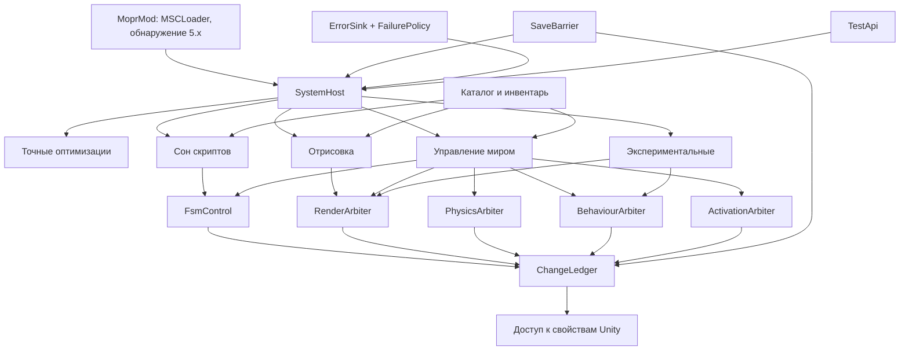
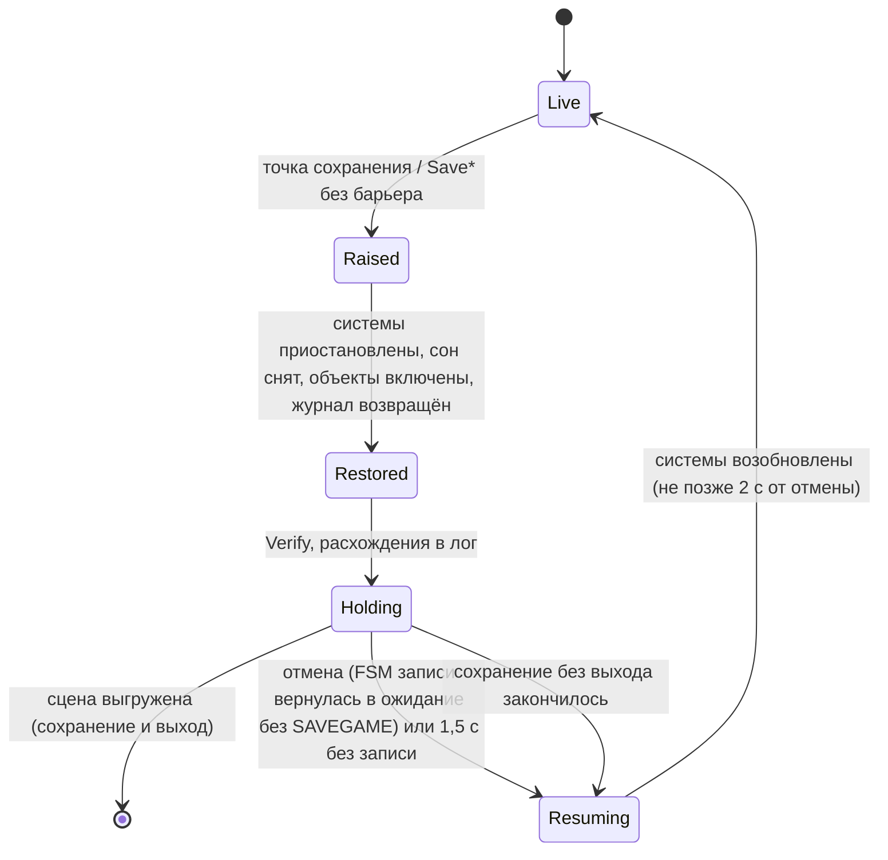

# Дизайн: MOPR 6.0 — переписывание с нуля под ванильную игру

Документ описывает, как выполняются требования из `requirements.md`. Ссылки вида «Т5.2» — требование 5,
критерий 2. Факты о PlayMaker проверены по декомпиляции `_reference/decomp/PlayMaker/`. Цифры — замеры TestBot
на MOPR 5.1.1.

## Обзор

Идея 6.0: не выключать мир, а снимать его стоимость по частям, и только там, где это доказуемо или проверено
стендом. Каждое изменение в объектах игры идёт через журнал с одним владельцем. Перед сохранением всё синхронно
возвращается к ванили.

Как устройство 6.0 исключает шесть типов ошибок 4.x:

| Ошибка 4.x | Чем исключается в 6.0 |
|---|---|
| 1. Перезапуск FSM, которая читает сейв | По умолчанию нет `SetActive(false)`. `RestartOnEnable` меняет только арбитр FSM; анализ RestartGuard включён всегда (§7, §9). |
| 2. Подмена кода «эквивалентным» | Точные оптимизации пропускают только доказанный холостой ход, у каждой есть режим проверки. Остальное — экспериментальный раздел, выключен (§6). |
| 3. Придуманные состояния физики | Физика только замораживается и возвращается через журнал. Стенд сравнивает rigidbody с ванилью (§9, §10). |
| 4. Несколько владельцев свойства | У каждого вида свойства один арбитр; журнал отказывает второму владельцу (§3). |
| 5. Отложенные изменения и сохранение | Граница сохранения срабатывает синхронно в том же вызове, что начинает сохранение. Страховка — хуки на действиях `Save*` (§4). |
| 6. Молча проглоченные исключения | Все исключения идут в `ErrorSink`. Модульный тест запрещает `catch` без отчёта (§12). |

## Структура репозитория

Всё, что относится к 6.0, лежит в одной папке `MOPR6`. Мод называется MOPR6 (ID и имя `MOPR6`), файл — `MOPR.dll`, как у 5.x (версия видна в логе).

```
MOPR6/
  MOPR6.csproj                  мод, net35 → MOPR.dll (компилирует Mod/** и Core/src/**)
  Mod/                          код мода (Unity)
    MoprMod.cs                 класс мода (MSCLoader), запуск, обнаружение 5.x
    Host/                       хост систем, реестр патчей Harmony
    Ledger/                     доступ к свойствам Unity, хуки «чужих писателей»
    Arbiters/                   FsmControl, RenderArbiter, PhysicsArbiter, BehaviourArbiter, ActivationArbiter
    Save/                       граница сохранения, точки сохранения
    Catalog/                    загрузка каталога, сопоставление со сценой, особые случаи
    Engine/                     точные оптимизации (перенос из Engine Lab)
    Dormancy/                   сон скриптов
    Render/                     отрисовка
    World/                      управление миром
    Experimental/               неточные оптимизации
    Diagnostics/                ErrorSink (Unity-часть), отчёт, консоль
    UI/                         настройки, локализация ru/en/pl, экран загрузки, проверка обновлений
    Testing/TestApi.cs          стабильный API для TestBot (через отражение)
  Resources/catalog/            inventory.json (генерируется), rules/*.json, chunks.json, fixes.json
  Core/                         логика без Unity: MOPR6.Core.csproj (net8.0) + src/ (компилируется и в мод)
    src/Ledger, Host, Errors, Catalog, Dormancy, Save, Snapshot, Bench
  Tests/                        MOPR6.Tests.csproj: xUnit, net8.0
  Tools/EquivCompare/           net8.0: сравнение снимков и сейвов, сводка замеров, сборка инвентаря
  Scenarios/                    сценарии стенда (eq-*.json) и замеров (bench.json)
  Equiv/                        expected.json (ожидаемые отличия), tolerances.json, baseline.json (эталон 5.1.1)
  Scripts/equiv.ps1             стенд эквивалентности одной командой
  Scripts/bench.ps1            набор замеров: ваниль / 5.1.1 / 6.0
  Docs/                         описание каждой системы
  CHANGELOG.md                  изменения 6.0
```

### Сборка

- `MOPR6.csproj`: net35, LangVersion 9.0, `AssemblyName=MOPR6`, `RootNamespace=MOPR6`, `TreatWarningsAsErrors`,
  `EnableDefaultItems=false` (вложенные `Tests/`, `Tools/` не попадают в мод).
  Ссылки и переключатель «настоящие сборки / заглушки» (`ManagedDir`) такие же, как в `MOPR.csproj`: UnityEngine,
  UnityEngine.UI, PlayMaker, Assembly-CSharp, ES2, MSCLoader, Newtonsoft.Json, 0Harmony 1.2, System.Core.
- Исходники ядра подключаются в мод так: `<Compile Include="Core\src\**\*.cs" LinkBase="Core" />`.
  В Mods кладётся один DLL. Сборка мода под net35 заодно проверяет, что ядро не использует API новее .NET 3.5.
- `MOPR6.Core.csproj`: только net8.0, без ссылок на Unity, LangVersion 9.0. Newtonsoft.Json: в моде — копия
  игры (MSCLoader), в ядре на net8 — закреплённая версия NuGet. Используются только `JsonConvert` и `JToken`.
- Тесты: xUnit и `Microsoft.CodeAnalysis.CSharp` (для проверки `catch`). Точные версии фиксируются при создании
  проекта.
- Имя сборки и пространство имён отличаются от 5.x (`MOPR`, `MOP.*`), идентификаторы Harmony — тоже
  (`mopr.<система>`). Так в одном процессе нет конфликтов имён.

Команды:

```powershell
dotnet build MOPR6\MOPR6.csproj -c Release "-p:ManagedDir=<игра>\mysummercar_Data\Managed"
dotnet test MOPR6\Tests
.\MOPR6\Scripts\equiv.ps1 -Set core     # стенд эквивалентности (Т14.3)
.\MOPR6\Scripts\bench.ps1              # замеры (Т4)
```

Общие инструменты (TestBot, `scripts/test-run.ps1`) меняются только добавлениями: новые операции, новый вариант
`mopr6`. Сценарии 5.x работают как раньше. Код мода 5.x не меняется (Т1.1).

## Архитектура



Слои: системы решают, что делать; арбитры сводят запросы систем в одно значение свойства; журнал хранит
исходные значения и выполняет запись; доступ к Unity — тонкий слой get/set. Ядро (журнал, арбитры как логика,
политики, каталог, сравнение снимков) не знает Unity и тестируется без игры (Т14.1).

## 1. Запуск, обнаружение 5.x, другие моды (Т1, Т2.3)

- `MoprMod : Mod`: ID `MOPR6`, имя «MOPR6», файл `MOPR.dll`, версия `6.0.0-preview.N`. Пока не выполнен Т4.4, в
  консоли при загрузке выводится «PREVIEW» (Т1.3).
- На `OnMenuLoad` проверяется `ModLoader.LoadedMods`: есть ли включённый мод с ID `MOPR` (сборка у обоих называется
  `MOPR`, поэтому проверяется только ID). Если есть, то
  `Conflict5x = true`: системы не устанавливаются, в консоли и на странице настроек — сообщение «нужен только
  один из них» (Т1.2). При загрузке игры сообщение повторяется.
- Порядок в `PostLoad` (сцена GAME): загрузить и проверить каталог → сопоставить со сценой (§5) → поставить хуки
  сохранения (§4) → установить системы по настройкам.
- Другие моды (все, кроме MSCLoader, MOPR6 и TestBot): одна строка в консоли «совместимость пока не
  поддерживается» (Т2.3). Через 10 с после загрузки сопоставление каталога повторяется: моды часто меняют FSM
  поздно. Объекты, чья структура изменилась, освобождаются (§5).
- Импорт настроек 5.x — только командой `mopr import5`: читает `Mod Settings/MOPR`, переносит известные ключи,
  пишет только в `Mod Settings/MOPR6` (Т1.4).

## 2. Хост систем (Т7.3, Т12.2)

```csharp
interface IOptimization
{
    string Id { get; }                 // "engine.fsmFastPath", "dormancy", "render.layers"...
    Tier Tier { get; }                 // Exact | Experimental
    string Install(SystemContext ctx, Mode mode);   // Mode: On | Verify; null = успех, иначе причина
    void Remove();                     // снять патчи, отпустить всё в журнале, очистить состояние
    void Suspend(string reason);       // перестать применять, всё вернуть (граница сохранения)
    void Resume();
    VerifyResult Verify();             // свои инварианты: всё, что держит система, равно применённому
    void Report(ReportWriter w);       // счётчики, расхождения режима проверки
}
```

- Состояния: `NotInstalled → Installed(On|Verify) ⇄ Suspended → Removed`, отдельно `Tripped` (снята после
  отказов). Машина состояний — в ядре и покрыта тестами.
- Включение и выключение в игре: `Remove()` полностью снимает систему (Т7.3). Патчи Harmony у каждой системы
  свои, со своим ID, и снимаются `UnpatchAll(id)`. Ошибка при снятии — в `ErrorSink`, не в пустой `catch`.
- Реестр патчей: хост знает, какие методы патчит каждая система. Если две системы патчат один метод, порядок
  задаётся явно (приоритет Harmony), иначе установка второй отклоняется.
- Изоляция отказов. Каждая точка входа системы (тик, префикс или постфикс Harmony, обработчик события) обёрнута:

```csharp
static bool UpdatePrefix(PlayMakerFSM __instance)
{
    if (!Sys.Live) return true;                        // снятая или отказавшая система: оригинал
    try { return Body(__instance); }
    catch (Exception ex) { Sys.Fail("Update.Prefix", ex, __instance); return true; }
}
```

  `Sys.Fail` пишет в `ErrorSink` и сразу ставит `Live = false`: все хуки системы пропускают оригинал. Снятие
  патчей и возврат журнала выполняются в конце кадра, а не внутри патченого вызова. `FailurePolicy` (ядро):
  больше 3 отказов за 60 с (скользящее окно) — система снимается, её записи в журнале возвращаются, в консоли
  сообщение (Т12.2). Отказ одной системы не трогает остальные.
- Главный выключатель (Т13.2): `Host.StopAll()` — снять все системы в обратном порядке, `Ledger.RestoreAll()`,
  `Verify`, отчёт в консоль.

## 3. Журнал изменений и арбитры (Т5)

### Модель данных (ядро)

```csharp
enum PropKind : byte
{
    GoActive, BehaviourEnabled, RendererEnabled, ColliderEnabled, Layer,
    RbKinematic, RbDetectCollisions, RbUseGravity, RbSleep,
    FsmEnabled, FsmRestartOnEnable, Parent, LocalPose,
    ShadowCasting, LightEnabled, LightShadows, CameraLayerCull, QualityShadowDistance,
    CreatedObject                       // объект, созданный модом (склейка мешей): при возврате уничтожается
}

struct PropKey   { int TargetId; PropKind Kind; }            // InstanceID + вид
struct PropValue { byte Type; bool B; int I; float F; float X, Y, Z, W; int RefId; }  // без упаковки
class  LedgerEntry
{
    PropKey Key; Owner Owner;            // Owner — арбитр
    PropValue Original, Applied;
    int AppliedFrame; int Seq;           // Seq — порядок применения (для возврата LIFO)
    EntryState State;                    // Held | External | Released
    string Path;                         // путь объекта, для логов
}
```

- Хранение: `Dictionary<long, LedgerEntry>`; ключ — `(TargetId << 8) | Kind`. Записи берутся из пула, в
  установившемся режиме за кадр ничего не выделяется.
- API: `Set(owner, target, kind, value) → Ok | DeniedOwner | TargetGone | Frozen`, `Release(owner, key)`,
  `ReleaseAll(owner)`, `RestoreAll()`, `Verify() → список расхождений`.
- Второй владелец: `DeniedOwner`, строка в лог. В отладочной сборке (`MOPR6_DEBUG`) — исключение (Т5.2).
- Во время границы сохранения журнал заморожен: любой `Set` возвращает `Frozen`.
- Доступ к Unity: `IPropertyAccess` (get/set по `PropKind`). В моде — реализация на Unity; в тестах ядра —
  фейки.

### Арбитры: один владелец на вид свойства

Системы не пишут свойства напрямую. Они ставят и снимают «причины» у арбитра; арбитр — единственный владелец
вида свойства в журнале и вычисляет итоговое значение.

| Арбитр | Виды свойств | Правило | Клиенты |
|---|---|---|---|
| FsmControl | FsmEnabled, FsmRestartOnEnable | FSM выключена, если есть причина «сон»; `RestartOnEnable = исходное && нет причин «пауза»` | сон скриптов, RestartGuard, мир |
| RenderArbiter | RendererEnabled, ShadowCasting, LightEnabled, LightShadows, CameraLayerCull, QualityShadowDistance | скрыт, если есть хоть одна причина | отрисовка, склейка, мир, экспериментальные |
| PhysicsArbiter | RbKinematic, RbDetectCollisions, RbUseGravity, RbSleep | заморожен, если есть причина и выполнены условия (тело в покое) | мир |
| BehaviourArbiter | BehaviourEnabled, ColliderEnabled | выключен, если есть причина | мир, экспериментальные |
| ActivationArbiter | GoActive, Parent | только для записей каталога с `deactivate`; порядок §9 | мир |

Причины считаются по ссылкам (`HashSet<SystemId>` на объект). Двух владельцев одного свойства нет по
устройству. Отказ журнала (Т5.2) остаётся страховкой от ошибок в коде.

### Внешние изменения (Т5.4)

Три механизма:

1. При возврате: если текущее значение ≠ `Applied`, свойство изменил кто-то другой. Журнал оставляет его
   значение, ставит `External` и пишет в лог (путь, вид, наше значение, их значение).
2. Хуки известных писателей: действия PlayMaker, которые пишут те же свойства (`ActivateGameObject`,
   `EnableBehaviour`, `SetProperty`, `SetIsKinematic`, `EnableFSM` и подобные; полный список — из декомпиляции на
   этапе 1). Префикс в `OnEnter` сообщает журналу о записи до того, как она произошла. Это закрывает случай,
   который механизм 1 не видит: игра пишет то же значение, что и мы (выключила уже скрытый нами рендерер). Без
   хука при возврате мы бы его включили.
3. Фоновая сверка: каждые 2 с проверяется небольшая порция записей. Найденный дрейф — `External` и лог
   «неизвестный писатель». Такие случаи разбираются и добавляются в механизм 2.

Пример из Т5.4: игрок взял замороженный предмет. Действие подбора пишет `isKinematic` → хук → `External` →
арбитр снимает заморозку с предмета, пока тот не вернётся в покой вне зоны игрока.

### Возврат

- `RestoreAll()`: записи возвращаются в обратном порядке применения (LIFO). Исключение — `GoActive`: родители
  включаются раньше детей.
- Объекты `CreatedObject` (склейка) уничтожаются после возврата видимости оригиналов.
- После возврата — `Verify()`: каждое свойство с записью равно `Original` (или помечено `External`).
  Расхождения пишутся в лог по пути (Т6.2). Проверка 5.3 — снимок стенда после `RestoreAll` против ванили по
  ключам из `TestApi.LedgerDump()` (§10).

## 4. Граница сохранения (Т6)

### Точки сохранения

Как в 5.x: объекты SAVEGAME (состояние, с которого начинается запись, и ожидание подтверждения «Wait for
click»), смерть, звонок Суски. 6.0 ставит префикс на `OnEnter` первого состояния записи. Барьер поднимается
синхронно, внутри этого вызова, до любого действия сохранения.

Страховка: префиксы на `OnEnter` действий ES2 `Save*` из Assembly-CSharp (пара к списку `Load*` RestartGuard).
Если сохранение началось, а барьер не поднят, барьер поднимается тут же, и в лог пишется «сохранение без
известной точки: <FSM>/<состояние>». Если окажется, что игра вызывает `Save*` и вне настоящего сохранения, эти
FSM разбираются и вносятся в каталог как «не точка сохранения».

### Последовательность



1. `Host.SuspendAll("save")`: системы перестают применять изменения, журнал заморожен.
2. Сон скриптов будит все FSM в исходном порядке (§7.4).
3. ActivationArbiter включает выключенные объекты (родители раньше детей), с окном RestartGuard.
4. `Ledger.RestoreAll()`, затем `Verify()` всех систем и журнала (Т6.1, Т6.2).
5. Игра пишет файлы — с ванильным состоянием.
6. Отмена (Т6.4): FSM записи опрашивается каждые 0,25 с. Если она вернулась в ожидание без события SAVEGAME
   (или 1,5 с без записи), то `ResumeAll()`. Системы применяют изменения заново по своим тикам. Срок «2 с»
   проверяется сценарием стенда.

Машина состояний барьера — в ядре (время подаётся снаружи), переходы покрыты тестами. Сравнение сейвов (Т6.3) —
§10.

## 5. Каталог ванильных объектов (Т11, Т2.1, Т2.2, Т10.5)

### Файлы (встроенные ресурсы)

| Файл | Что | Кто пишет |
|---|---|---|
| `inventory.json` | Все FSM и управляемые объекты ванили: путь, имя, хеш структуры | генерируется (`EquivCompare catalog build`) из дампа ванили, руками не правится |
| `rules/*.json` | Правила: что можно делать с объектом или классом объектов | вручную |
| `chunks.json` | Части мира для управления миром (§9): объекты, точки, дистанции | вручную + результаты A/B |
| `fixes.json` | Каждое исправление MOP 3.10 и 5.x: куда перенесено или почему не нужно | вручную |

### Инвентарь: что значит «только ваниль»

Дамп снимается операцией TestBot `inventory` на ванили (только MSCLoader и TestBot) сразу после загрузки.
Для каждой FSM: путь, имя FSM, индекс среди одинаковых, стартовое состояние и хеш структуры: имена состояний,
переходы, типы действий по порядку, глобальные переходы. Для объекта: отсортированный список типов компонентов
и число детей. В инвентаре также записан хеш `Assembly-CSharp.dll`: если игра обновилась, при загрузке
выводится предупреждение, а несовпавшие объекты пропускаются.

Сопоставление в игре:
- статические объекты сцены — по пути при загрузке;
- порождённые из сейва и купленные (предметы) — по шаблону имени и хешу структуры, когда они появляются
  (новые FSM находятся по приросту `PlayMakerFSM.FsmList` в медленном тике).

Объект или FSM, которых нет в инвентаре или чей хеш не совпал (мод добавил компонент, вставил действие через
FsmHook, изменил детей), 6.0 не трогает: лог «пропущено: <путь>, причина: <что не совпало>» (Т2.2, Т11.3).

Точные оптимизации (§6) состояния не меняют, но по Т2.1 тоже ограничены инвентарём: признак «в инвентаре»
кешируется на экземпляр FSM, поэтому проверка почти бесплатна. Расширение на FSM модов — этап 5.

### Правило каталога

```json
{
  "id": "yard.woodshed.door",
  "match": {
    "path": "YARD/Building/WOODSHED/Door",
    "class": null,
    "expect": { "count": 1, "components": ["BoxCollider", "MeshRenderer", "PlayMakerFSM"], "fsms": ["Use"] }
  },
  "chunk": "home",
  "allow": { "render": true, "sleep": true, "behaviours": [], "physics": false, "deactivate": false },
  "distance": { "render": 150, "behaviours": null },
  "when": ["player.notInside"],
  "noRestart": ["Use"],
  "special": [ { "kind": "fsmStateWipe", "fsm": "Use", "state": "State 1" } ],
  "source": "MOP 3.10 GameFixes: …",
  "test": "MOPR6/Scenarios/eq-home-yard.json"
}
```

- `match.class` вместо `path` задаёт класс: шаблон пути и имени FSM, например все `Screw` под `CARPARTS`.
  `expect.count` — сколько ожидается.
- `when` — именованные условия из реестра в коде (`player.notInside`, `vehicle.engineOff`, `rb.atRest`…).
  Данные говорят, какие условия нужны; код их реализует.
- `special` — особые случаи из закрытого списка видов. Каждый вид — класс в `Mod/Catalog/SpecialCases/` со своим
  тестом. Произвольного кода в данных нет.
- `noRestart` дополняет автоматический анализ RestartGuard, а не заменяет его (Т11.4).

### Проверка

- Модульные тесты (ядро, без игры): схема и обязательные поля, уникальные `id`, известные виды действий,
  условий и особых случаев, файл `test` существует, каждый шаблон находит записи в `inventory.json` и их число
  равно `expect.count`, у каждой записи `fixes.json` есть цель или причина.
- При загрузке в игре: число сопоставленных и пропущенных по каждому правилу — в отчёт (§12).

### Перенос исправлений MOP 3.10 и 5.x (Т11.2)

Предварительная разбивка; решение по каждому исправлению записывается в `fixes.json` на этапе 4.

| Группа | Примеры из 5.x | При способе 6.0 |
|---|---|---|
| Защита от перезапуска FSM при выключении | State 1 у ремня генератора, масляного фильтра, свечей, аккумулятора; RestartOnEnable бака; BoltsFix и SatsumaBoltsAntiReload; краска; менеджеры петель; masked elements; «Fix Collider» в LOD | Не нужны: объекты не выключаются. Нужны только для правил с `deactivate`, и там их закрывает RestartGuard + `noRestart`. |
| Переподчинение объектов ради выключения | Перяйярви, предметы коттеджа, звук в `MOP_<имя>`, junk cars, HUMANS | Не нужны: места и транспорт не выключаются. |
| Проваливание и физика при включении | ItemAntiClip, SatsumaPartMassManager, коллайдеры, CCD DriverHeadPivot, collider_floor3 | Без выключения не нужны. С заморозкой физики — проверяются по одному. |
| Отрисовка (renderQueue, материалы) | номера и приборная панель, часы, обёртка окна, краска решётки | Нужны, если перенесена соответствующая оптимизация отрисовки, и только вместе с ней. |
| Прочие исправления игры | остальное из GameFixes.MainFixes | Каждое разбирается: если это ошибка ванили, а не MOP, то «не переносится: 6.0 не меняет игровой процесс». |

## 6. Точные оптимизации (Т7)

| Система 6.0 | Источник 5.x | Что меняется при переносе |
|---|---|---|
| `engine.fsmFastPath` | `FsmFastPath.cs` (726 строк) | Классификатор выносится в общий модуль: его же использует сон (§7). `catch` → `Sys.Fail`. |
| `engine.redundantWrites` | `RedundantWrites.cs` (226) | Только перенос и обработка ошибок. |
| `engine.fsmProperty` | `FsmPropertyFastPath.cs` (473) | До переноса выяснить причину `TargetException` в `GetProperty.OnUpdate` через `FsmProperty.GetValue_Patch1`: 2–30 за прогон, только с MOPR. Перенос — после сценария, который её воспроизводит (Т14.4). |
| `engine.ik` | `IkFastPath.cs` (380) | Только перенос. |
| `engine.mouseRay` | `SharedMouseRay.cs` (434) | Только перенос. |

- Семантика та же: пропуск только при доказанном холостом ходе по живому состоянию, иначе оригинал (Т7.1).
  Доказательство для каждой системы — в комментарии к коду и в `MOPR6/Docs/` построчно по декомпиляции, как
  в `FsmFastPath.cs`.
- Режим `Verify` (Т7.2): оригинал выполняется всегда, заявленное «ничего не изменилось» сверяется после.
  Расхождения считаются, первые 50 пишутся в лог с объектом и состоянием. Условие приёмки — 0 расхождений на
  всех сценариях стенда (Т7.4).
- Экспериментальный раздел (Т7.5): `MirrorRate`, `EngineBayCulling` и подобные, выключены по умолчанию, со
  своими переключателями. В отчёте и консоли помечены «experimental».
- Не переносятся: `ModScripts` (моды — этап 5), `FrameGeneration` (не цель).

## 7. Сон скриптов (Т8)

Основа — проверенный на болтах механизм `BoltSleep` 5.1.1, обобщённый на все FSM инвентаря. Отдельной системы
«спящие болты» в 6.0 нет: болты — частный случай.

### 7.1. Когда FSM засыпает (Т8.1)

Решение принимает `SleepPolicy` (ядро) по фактам, которые Unity-слой собирает о FSM (`FsmFacts`):

| Условие | Откуда |
|---|---|
| FSM в инвентаре и хеш совпал | §5 |
| Классификатор быстрого пути даёт «покой» (состояние завершено) — ступень 1; или «таймер» (работа только `StateTime += deltaTime`) — ступень 2 | `FsmFastPath`: вошла, нет `switchToState`, нет отложенных событий, все `loopCount = 0`, владелец жив |
| Ни одно активное действие не переопределяет покадровые методы: `OnUpdate`, `OnLateUpdate`, `OnFixedUpdate`, `OnGUI`, `DoAnimatorIK` и т. п. | кеш по типу действия |
| Нет флагов `Handle*` (триггеры, столкновения, FixedUpdate, OnGUI, события приложения) — ступени 1–2 | `Fsm.Handle*` |
| Никто не читает `enabled`/`Active` этой FSM: нет действий `GetProperty`/`SetProperty`/`EnableBehaviour`, нацеленных на неё | статический анализ всех FSM при установке |
| На объекте ровно одна PlayMakerFSM — пока не доказано обратное для нескольких | как в BoltSleep |
| Условие держится ≥ 30 кадров и ≥ 0,5 с (гистерезис) | `SleepPolicy` |
| FSM не в списке «беспокойных»: больше 5 пробуждений за 10 с — запрет на сон с затуханием | `SleepPolicy` |

### 7.2. Как спит

Как в BoltSleep, через FsmControl:
- засыпание: `RestartOnEnable = false` (причина «сон»), затем `PlayMakerFSM.enabled = false`;
- пробуждение: `enabled = true`, затем `RestartOnEnable` возвращается.

По декомпиляции PlayMaker 1.6:
- `PlayMakerFSM.OnDisable`: `fsmList.Remove(this)`, затем, если `!Finished`, `Fsm.OnDisable → Stop()`. При
  `RestartOnEnable = false` `Stop()` только ставит `Finished = true`: состояние не сбрасывается, `OnExit` не
  вызывается.
- `PlayMakerFSM.OnEnable`: `fsmList.Add(this)`, затем `Fsm.OnEnable`: `Finished = false`. Если `ActiveState`
  не null и `RestartOnEnable = false`, перезапуска нет.

Значит, сон меняет только две вещи: место в `FsmList` (его возвращает §7.4) и место в списке Update самого
Unity (§16, риск 1).

### 7.3. Пробуждение до события (Т8.2, Т8.3)

| Путь события | Хук | Что делает |
|---|---|---|
| Событие FSM самой себе, `SendEvent`, `SendMessage("SendEvent")`, мышь (`PlayMakerMouseEvents` → `Fsm.Event`) | префикс `Fsm.ProcessEvent` (как в BoltSleep) | если у спящей есть переход на событие (текущее состояние или глобальный) — разбудить до обработки |
| Всем: `Fsm.BroadcastEvent`, `PlayMakerFSM.BroadcastEvent` | префикс | быстрый отказ по счётчику «сколько спящих ждут это событие»; иначе разбудить ждущих до копирования списка |
| Объекту и объекту с детьми: `BroadcastEventToGameObject` | префикс | разбудить спящих на объекте (и детях), у которых есть переход |
| FSM на объекте по имени: `SendEventToFsmOnGameObject` | префикс | разбудить |
| Поиск: `PlayMakerFSM.FindFsmOnGameObject` | префикс | разбудить всегда: поиск идёт по `fsmList`, где спящей нет |
| Копия списка: `Fsm.FsmList` (и `Fsm.SortedFsmList` через него) | префикс геттера (как в BoltSleep) | разбудить всех: вызывающий код сам обходит список |
| Действие `EnableFSM` (`OnEnter`/`OnExit`) | префикс | разбудить до переключения |
| Посредники `PlayMakerTrigger*`, `PlayMakerCollision*`, `PlayMakerFixedUpdate` (проверяют `playMakerFSM.Active` до передачи) | ступени 1–2: такие FSM не спят (флаги `Handle*`); ступень 3: префикс на методе посредника будит FSM до проверки `Active` | Т8.3 |
| Переменные (`GetFsm*`/`SetFsm*`) | не нужен | работают через `GetComponents` и со спящей; запись переменной сама ничего в FSM не запускает, а покадровых действий у спящей нет |

Геттер `PlayMakerFSM.FsmList` не патчится: через него сам PlayMaker делает каждую рассылку
(`Fsm.BroadcastEvent`, `BroadcastEventToGameObject`, `SendEventToFsmOnGameObject`), и хук будил бы всех на
каждом событии. Вместо этого на этапе 3 IL `Assembly-CSharp.dll` сканируется на вызовы `PlayMakerFSM.get_FsmList`
и чтение `Fsm.Active`/`PlayMakerFSM.enabled`. Для каждого найденного места либо ставится хук, либо записывается,
почему оно не важно. Так же проверяется, что короткие патченые методы не встраиваются JIT Mono в вызывающий код
(тест в игре: вызов из Assembly-CSharp + счётчик хука).

### 7.4. Порядок в списке FSM (Т8.4)

В ванили `fsmList` упорядочен по времени последнего `OnEnable`. `OrderKeeper` (логика в ядре):
- у каждой FSM есть отметка `stamp`: при установке — по текущему индексу в списке; дальше — постфикс
  `PlayMakerFSM.OnEnable` для всех FSM ставит `++counter`, кроме наших пробуждений;
- список всегда отсортирован по `stamp`: добавление идёт в конец с максимальной отметкой, удаление порядок не
  нарушает;
- пробуждение: `OnEnable` добавил FSM в конец → `RemoveAt(last)` → `Insert(LowerBound(stamp), pm)`. Это ровно то
  место, где FSM была бы в ванили, где она не уходила из списка. Стоимость — двоичный поиск и сдвиг ~1500 ссылок.

Если игра выключила и включила объект спящей FSM, в ванили она тоже ушла бы из списка и вернулась в конец.
Тогда FSM получает новую отметку, как при обычном `OnEnable`.

### 7.5. Выключение объекта спящей FSM (Т8.5)

Как в BoltSleep. Компонент-сторож на объекте ловит `OnDisable` и `OnEnable` объекта.
- Объект выключили и включили, пока FSM спала: `RestartOnEnable` возвращается до включения компонента, и FSM
  перезапускается ровно как в ванили (там её сбросил бы `OnDisable`, а `OnEnable` запустил бы заново).
- Разбудили, пока объект выключен: `Stop()` с исходным флагом, как сделал бы `OnDisable`.
- Чужое включение компонента: префикс и постфикс `OnEnable`.
- Объекты, которые выключает сам 6.0 (правила `deactivate`): FsmControl сводит причины «сон» и «пауза
  RestartGuard». `RestartOnEnable` возвращается, только когда снята последняя причина.

### 7.6. Таймеры (ступень 2, Т8.6)

В ванили каждый кадр, пока состояние не завершено, выполняется `StateTime += Time.deltaTime`
(`FsmState.OnUpdate`). `DeltaLog` записывает `Time.deltaTime` каждого кадра (одно значение на кадр, общее для
всех спящих). При пробуждении `TimerAccumulator` (ядро) прибавляет к `StateTime` значения за пропущенные кадры
по одному, в том же порядке. Получаются те же операции с плавающей точкой, что в PlayMaker, а не одно сложение
суммы.

Граничный кадр пробуждения учитывается ровно один раз. Если Unity вызовет `Update` только что включённой FSM в
этом же кадре, прибавление сделает сама игра (это видно по префиксу `Update`). Если нет — его делает
завершитель в конце кадра. Как Unity 5.0 ведёт себя в этом случае, проверяется тестом на этапе 3. Режим
проверки сравнивает `StateTime` побитово.

Если спящий таймер не будили дольше 36 000 кадров, его будит медленный тик: журнал кадров не растёт без
предела.

### 7.7. Режим проверки сна (Т8.7)

«Виртуальный сон»: учёт ведётся как при сне (счётчики событий, хуки пробуждения), но FSM не выключается и
работает. Каждый кадр после её `Update`/`LateUpdate` сверяется:
1. Оригинал ничего не изменил: активное состояние, `activeStateEntered`, `switchToState`, число отложенных
   событий, счётчики циклов, хеш переменных. Для ступени 2 — `StateTime` побитово против `TimerAccumulator`.
2. Каждое событие, обработанное «спящей» FSM, было предварено пробуждением. Событие без пробуждения — значит,
   найден пропущенный путь события.

Расхождения считаются и пишутся в лог с FSM, состоянием и путём события. Условие включения каждой ступени —
0 расхождений на всех сценариях стенда.

### 7.8. Стоимость обслуживания (Т8.8)

Хуки не выделяют память. Признак «спит» хранится в словаре по ссылке; при 0 спящих хук сразу выходит. В
профильном режиме `Stopwatch` считает время в хуках, засыпаниях и пробуждениях. Экономия измеряется A/B
(включено/выключено блоками по 1 с). В отчёте: «обслуживание X мс, экономия Y мс, X/Y < 5%».

## 8. Отрисовка (Т9)

| Система | Источник 5.x | Через что |
|---|---|---|
| `render.layers` — дистанции слоёв | `RenderOptimizer.cs` | RenderArbiter: `CameraLayerCull` |
| `render.shadows` — тени | `RenderOptimizer.cs` | `QualityShadowDistance`, `ShadowCasting` |
| `render.lamps` — лампы | `RenderOptimizer.cs`, `RoofLampFix.cs` | `LightEnabled`, `LightShadows` |
| `render.satsumaMerge` — склейка стоящей Satsuma | `MeshMerger.cs`, `VehicleMeshMerge.cs` | `CreatedObject` + `RendererEnabled` (причина «склейка») |

- Отрисовка меняет только виды свойств RenderArbiter. Активность, физика и скрипты отрисовке недоступны по
  устройству: у неё нет других арбитров (Т9.1).
- Склейка снимается до любого взаимодействия с машиной (логика 5.x) и при границе сохранения.
- Проверка картинки (Т9.2): в детерминированном режиме стенда (§10.1) скриншоты ванили и 6.0 снимаются в тех
  же точках на том же кадре и сравниваются `scripts/ImageDiff.ps1`. Допуск задаётся для каждой оптимизации в
  `MOPR6/Equiv/tolerances.json`: доля отличающихся пикселей и максимальная разница канала.
- Возврат перед сохранением и по «вернуть всё» — через журнал (Т9.3).

## 9. Управление миром (Т10)

### 9.1. Действия по умолчанию — без выключения (Т10.1)

| Действие | Как | Точность |
|---|---|---|
| Не рисовать | RenderArbiter скрывает рендереры правила дальше `distance.render` | Картинка вне видимости; проверка скриншотами |
| Скрипты | Сон скриптов (§7) уже работает везде и доказуемо. Для неспящих FSM дальней части мира — только «пауза» FSM из правила, с обоснованием (например, чисто визуальное мигание) | Пауза — не точная, проверка стендом |
| Компоненты | BehaviourArbiter выключает перечисленные в правиле компоненты (например, UnityCar стоящей машины) при условиях `when` | Не точная, проверка стендом |
| Физика | PhysicsArbiter замораживает тело в покое (`rb.atRest`) | Не точная, проверка стендом |

Дистанции и условия задаются в `chunks.json` и `rules/*.json` (Т10.5). Начальные значения — из 5.x: предметы
75 м, транспорт 125 м, места от 175 м. Гистерезис: выключение на `d`, включение на `0,9·d`. Тик каждые 0,5 с,
обработка порциями (не больше N объектов за кадр), чтобы не было пиков.

### 9.2. Полное выключение (Т10.2)

Система `world.deactivate` (`Mod/World/Dormancy.cs`), через ActivationArbiter (`GoActive = false`). Её модель
защиты построена на классах ошибок 4.x/5.x:

| Ошибка 5.x | Почему | Защита в 6.0 |
|---|---|---|
| FSM при включении начинает с начала и перечитывает сейв | `OnDisable → Stop → StopAndReset`, `OnEnable` с `RestartOnEnable` запускает стартовое состояние | Перед `SetActive(false)` всем FSM выключаемой части — FsmPause (`RestartOnEnable = false`, не только тем, чей путь запуска читает сейв, как в 5.x). Возврат: сначала `SetActive(true)`, потом флаг. Журнал при `RestoreAll` возвращает `FsmRestartOnEnable` после `GoActive` |
| События уходят в выключенный объект и теряются | `Fsm.ProcessEvent` выходит, если FSM не `Active` | В выключенной части только FSM, которые спят бы по §7.1 (простой, ничего не ждут, кроме событий). Все пути событий §7.3 будят часть до события: поиск по FSM, рассылка, `EnableFSM`, `Fsm.FsmList` |
| Объект, который игра ищет по имени, не находится | `GameObject.Find` не видит выключенных | Префикс `FindGameObject`: имя или тег из выключенной части — разбудить до поиска. `GameObject.Find` из скриптов C# не перехватывается (известный пробел) |
| Действие игры с выключенным объектом (анимация, звук, включение) не срабатывает | цель неактивна | Префикс `Fsm.GetOwnerDefaultTarget`: действие снаружи части с целью внутри — разбудить до действия; только чтение (`Get*`) — нет |
| Предметы проваливаются | пропал коллайдер под ними | Коллайдеры, которых касается чужое тело (предмет, машина: сфера вокруг тела и луч вниз), остаются. Чужое тело, которое сдвинулось у выключенной части или появилось в ней, будит её |
| Здания пропадают вдали (5.x выносил их из мест) | выключен рендерер | Рендерер, который с ближайшей точки до включения больше 2 пикселей, остаётся включённым вместе с родителями |
| Звук, анимация, частицы, свет обрываются | Unity останавливает их при выключении | Объект с играющим звуком (кроме `loop` + `playOnAwake`), анимацией, частицами, включённым светом, `Animator` остаётся |
| Чужой скрипт / ловец триггеров и столкновений | неизвестно, что он делает при `OnDisable` | Остаются: незнакомые скрипты (разрешены только известные пассивные типы Unity), FSM с `Handle*`, с переходами на сообщения Unity, не ванильные, со вложенными FSM; суставы; камеры |

Остальное остаётся включённым по правилам «хранителей». Часть мира (машина, место 5.x) — это корень; выключаются
наибольшие поддеревья без хранителей («покрытие»), их родители и хранители работают дальше. Если хранителей нет,
выключается корень целиком.

Когда: игрок дальше `d` (машины 125 м, места — дистанции 5.x) не меньше 10 с, все FSM покрытия простаивают и 10 с
не входили в состояния; машина — только замершая (`world.vehicles`).

Места с покрытием выигрыша не дали (игра сама выключает их содержимое), система оставлена для машин. Машина
выключается целиком, вместо неё рисуется неподвижная копия (`StandIn`, объекты журнала). Видимые части, коллайдеры
и занятые FSM тогда не хранители; занятая FSM допускается, если 10 с у неё то же состояние и те же переменные (кроме
выходов `Get*`, читающих мир вне машины), а цикл с `Wait` прошёл круг без изменений. Хранители машины: таймеры
кроме `Wait`, действия со своим `Event`, FSM, которая читает управление игрока (включённый `AxisCarController`,
клавиши) в состоянии с переходами, суставы кроме петель, жёстких, пружинных и `CharacterJoint`, машина в чужом
триггере, чужая тяжёлая машина вплотную. Предметы на машине на это время kinematic. Каждый сустав сверяется после
включения; сдвинувшийся запрещает машине выключаться до конца сеанса. Включение — ближе `0,9·d`, по любому событию,
поиску, действию или телу из таблицы выше, при оттаивании машины, перед границей сохранения, главным
выключателем и `mopr restore`. Узлы покрытия дальше `d/2` от корня остаются (игрок к ним ближе, чем к корню).
После включения — 30 с без повторного выключения; больше 3 включений событиями за 5 мин — запрет с удвоением
(`DormancyPolicy`, ядро). Если игра сама переключила выключенный корень (`Dropped`), часть включается вся и
получает запрет.

Порядок в `fsmList` при включении восстанавливает `OrderKeeper` (§7.4), поэтому система работает только вместе
со сном скриптов (его хуки событий). Порядок `Update` Unity не восстанавливается, но FSM покрытия простаивают.
Предметы в транспорте (Т10.3) не проваливаются по устройству: опора чужого тела не выключается.

Режим проверки («виртуальное выключение»): покрытие считается, индекс пробуждений ведётся, но ничего не
выключается. Вход FSM покрытия в состояние без пробуждения — расхождение (найден пропущенный путь). Отчёт: по
каждой части — состояние, размер покрытия, хранители по видам, пробуждения по причинам, время выключения и
включения.

### 9.3. Решение по каждой части мира: A/B

Части мира — из `chunks.json` (дом, двор, Перяйярви, Тейму, места 5.x и т. д.). Для каждой:
1. Режимы: M0 — ничего; M1 — действия §9.1; M2 — M1 + выключение.
2. Замер по `bench` в точках, где часть далеко. Плюс одна точка, где часть рядом, — там эффекта быть не должно.
   M1 и M2 сравниваются отдельными запусками, по 3 на режим (переключать `SetActive` раз в секунду для A/B
   нельзя).
3. Выключение разрешается, если M2 быстрее M1 хотя бы в одной точке на ≥ 0,15 мс времени кадра (больше шума) и
   стенд в M2 даёт 0 необъяснённых расхождений.
4. Решение записывается в правило с доказательством: `"evidence": "bench <дата>: M1→M2 −0,31 мс, eq-full ok"`.

## 10. Стенд эквивалентности (Т3)

### 10.1. Детерминированный режим

Если сравнивать два запуска игры как есть, в них разные кадры, разное `deltaTime` и разные случайные числа.
Мод меняет FPS, а значит, и время каждого кадра. Поэтому сценарии стенда идут в детерминированном режиме
TestBot:
- `Time.captureFramerate = 60`: каждый кадр продвигает игровое время ровно на 1/60 с, независимо от FPS.
  Таймеры FSM, корутины и число шагов физики на кадр совпадают у ванили и мода.
- `UnityEngine.Random.seed` ставится при загрузке сцены GAME (`OnLevelWasLoaded`) и ещё раз в точке синхронизации:
  через `SyncFrames` (1200) кадров после загрузки сцены. Точка по «игрок получил управление» не годится: этот
  момент зависит от числа модов у MSCLoader.
- Снимки и сохранения — по номеру кадра от точки синхронизации.
- Блокировка ввода (`InputLock`): клавиатура, мышь и контроллер не доходят до игры. Причина: окно игры получает
  фокус, и человек за компьютером двигает мышь, нажимает Escape или Alt+Tab. Это замечено во всех прогонах.
  Блокировка одна и та же у ванили и мода.
- Правило для 6.0: мод никогда не вызывает `UnityEngine.Random`, чтобы не сдвигать последовательность игры.

Что остаётся недетерминированным (замерено, `MOPR6/Docs/harness.ru.md`):
- собственная загрузка игры занимает разное число кадров (управление через 348–376 кадров);
- случайные события: осиные гнёзда, гром, видеопокер, комар;
- трафик, NPC, HUMANS;
- оседание физики (стоящая Satsuma — около 1 мм);
- предметы, падающие под карту в сейве игрока.

Поэтому шум оценивается несколькими прогонами ванили (§10.4), а не одним. Замеры FPS (§11) идут без
`captureFramerate`.

### 10.2. Снимок сцены (Т3.1)

Новый `FullSnapshot` в TestBot (`StateSnapshot` 5.x видит только включённые объекты). Обход всех объектов сцены,
включая выключенные (`hideFlags == None`, как `PartSnapshot`). Объекты мода (`MOPR_*`) и TestBot исключаются.

| Что | Ключи |
|---|---|
| Объект | `activeSelf`, слой, путь родителя |
| PlayMakerFSM | `enabled`, `RestartOnEnable`, активное состояние, `Finished`; все переменные: float, int, bool, string, Vector2/3, Color, Quaternion, Rect, GameObject (путь), Object (имя) |
| Глобальные переменные PlayMaker | все, теми же типами |
| ArrayList/HashTable прокси | содержимое (как `PartSnapshot`) |
| Предметы, транспорт, детали | родитель, мировые положение и поворот |
| Rigidbody | `isKinematic`, `useGravity`, `detectCollisions`, скорость, угловая скорость, `IsSleeping`, масса, ограничения |
| Свойства из `PropKind` | `Renderer.enabled`, `Collider.enabled`, `Behaviour.enabled`, тени и свет — нужно для проверки Т5.3 |

Формат — TSV `ключ\tзначение`, отсортированный, сжат gzip. Числа пишутся с явным форматом (`"R"`) и
`InvariantCulture`: Mono 2.x и .NET 8 по умолчанию форматируют float по-разному. Снимок может остановить игру
на 1–3 с; в детерминированном режиме это не влияет на результат.

### 10.3. Сравнение сейва (Т3.2)

После настоящего сохранения (`savegame`: «SAVE AND QUIT TO MENU») операция TestBot `savecopy <метка>` копирует
папку сейва в папку прогона. Разбор идёт на хосте, вне игры: `Es2Parser` в ядре читает формат ES2 по
декомпиляции `ES2.dll` игры (`MOPR6/Docs/harness.ru.md`). `ES2.LoadAll` в игре не подходит: для каждого тега
Transform или коллайдера он создаёт объект в сцене (`ES2Type.GetOrCreate`).

Канонический вид: числа — с допуском, Vector3 и Quaternion — покомпонентно (кватернион с нормализацией знака),
Transform — положение, поворот, масштаб, списки и словари — поэлементно. Меши (`meshsave.txt`) и неизвестные
типы сравниваются как длина + MD5 тега.

### 10.4. Классификация расхождений (Т3.3, Т3.4)

Каждый сценарий запускается N раз без модов (ваниль V1…VN, по умолчанию N = 3) и один раз с модом M. Для ключа
`k` в контрольной точке:
1. M совпадает (с допуском) хотя бы с одним прогоном ванили → совпадает.
2. Прогоны ванили расходятся между собой (значение или наличие ключа) → шум: ключ нестабилен и в ванили.
3. `k` подходит под запись `MOPR6/Equiv/expected.json` → объяснённое.
4. Иначе → необъяснённое, ошибка прогона.

```json
{ "Pattern": "TRAFFIC/*.pose", "Scenario": "*", "Reason": "трафик: порядок операций PhysX", "Since": "6.0.0-preview.1" }
```

- Ключи только в одном варианте — отдельные списки «только в ванили» и «только в моде».
- Записи `expected.json`, которые ни разу не сработали, перечисляются в отчёте как устаревшие.
- Допуски — в `MOPR6/Equiv/tolerances.json` по виду ключа, у каждого правила — причина. Начальные значения по
  замеру: положение 5 мм, поворот 0,1°, скорость 0,02 м/с, float — округление.
- Прогон, в котором реальный ввод дошёл до игры без блокировки (`report.json`: `InputFrames`, `InputLocked`),
  `EquivCompare` не принимает.
- Логика классификации — в ядре (`SnapshotComparer`, `ExpectedDiffs`), с модульными тестами.

### 10.5. Сценарии (Т3.5)

| Сценарий | Что проверяет | Новые операции TestBot |
|---|---|---|
| `eq-home-yard` | дом и двор, снимки в нескольких точках | — |
| `eq-perajarvi-trip` | поездка в Перяйярви и обратно на Satsuma | `drive` (есть) |
| `eq-teimo-buy` | магазин Тейму, покупка, предмет появился | `buy` |
| `eq-car-work` | открутить и закрутить болты, снять и поставить деталь | `screw`, `detach`, `attach` (или через `fsmevent`/`fsmstate`) |
| `eq-walkaway` | уход от машины на 40 м и на 2 км и возвращение | — |
| `eq-sleep` | сон в кровати | `sleepbed` |
| `eq-save-load` | сохранение, выход, загрузка; копия сейва; проверка Т6.4 (отмена сохранения → возобновление ≤ 2 с) | `savecopy` (есть), `savecancel` |
| `eq-long` | ≥ 30 минут игрового времени: петля из действий выше | `repeat` (есть) |
| `eq-restore` | `TestApi.RestoreAll()` в нескольких точках → снимок против ванили по ключам `LedgerDump()` (Т5.3), без шума | `mopr` |

Наборы:
- `core` — `eq-home-yard`, `eq-save-load`, `eq-car-work`, `eq-restore`; около 30 минут;
- `full` — все сценарии.

### 10.6. Запуск одной командой (Т3.6, Т3.7, Т14.3)

`MOPR6/Scripts/equiv.ps1 -Set core|full`:
1. Собирает 6.0 и TestBot.
2. Для каждого сценария вызывает `test-run.ps1` N + 1 раз: `-Variant vanilla` ×N и `-Variant mopr6`. В варианте
   `mopr6` сборка 6.0 ставится как `Mods\MOPR.dll`; файл игрока сохраняется и возвращается после прогона.
3. Сохранение сейва и проверку по MD5 даёт `test-run.ps1`, как сейчас.
4. Затем `EquivCompare equiv` пишет `_testruns/equiv-<время>/report.md` и `report.json`: по сценарию и
   контрольной точке — число совпавших, шума, объяснённых и необъяснённых; первые 50 необъяснённых с тремя
   значениями; кадр первого расхождения.
5. Код выхода 1, если есть необъяснённые.

Права администратора не нужны: только файлы пользователя и запуск игры через Steam.

## 11. Замеры производительности (Т4)

- Точки (`MOPR6/Scenarios/bench.json`): дом изнутри (гостиная), двор, Перяйярви, дорога в езде (маршрут
  `drive`), магазин Тейму. Координаты, направление и наклон взгляда берутся из сценариев 5.x (smoke, b7,
  bmsc-attrib2) и фиксируются. Время суток задаётся в начале и проверяется в отчёте. `Random.seed`
  фиксирован, `captureFramerate` не используется.
- В каждой точке 10 с на установление и 20 с замера. Метрики (Т4.2): средний FPS, медиана, p95 и p99 времени
  кадра, выделение МБ/с, число сборок мусора. Всё это TestBot уже меряет (`measure`).
- Варианты: ваниль, 5.1.1 (эталонный DLL, путь и MD5 `9331301C255B7F9CB75A8D1C3EC43AE0` — в
  `MOPR6/Equiv/baseline.json`), 6.0. Каждый вариант запускается 3 раза.
- Правило ворот (Т4.4), ядро `Bench.Gate`: в каждой точке `FPS₆ ≥ FPS₅.₁.₁ − max(2σ, 1%)` и
  `p99₆ ≤ p99₅.₁.₁ + max(2σ, 2%)`, где σ — объединённое отклонение трёх запусков.
- Вклад каждой системы (Т4.3): операция `ab6` (система, режимы A/B, блоки по 1 с) через
  `TestApi.SetMode`, как `ab` сейчас.
- `MOPR6/Scripts/bench.ps1` запускает все варианты, затем `EquivCompare bench` строит таблицу (точки × варианты) и
  вердикт ворот.

## 12. Ошибки и диагностика (Т12)

- `ErrorSink` (ядро): ключ — место (`система/метод`) + тип исключения. Первый раз — полный стек, путь объекта
  и контекст. Дальше только счётчик; итог по ключу — в отчёте (Т12.1).
- Запрет молчаливых `catch`: модульный тест разбирает исходники `MOPR6/Mod/**` и `MOPR6/Core/**` через
  Roslyn. Каждый `catch` должен вызывать `Sys.Fail`/`Errors.Report` или пробрасывать исключение. Исключения из
  правила — только с атрибутом-комментарием `// catch-ok: <причина>`, и тест выводит их список.
- Отчёт для багрепорта: `mopr report` → `Mod Settings/MOPR6/report-<дата>.txt` на английском (Т12.3):
  - версия, preview или нет, хеш игры против инвентаря;
  - включённые системы, их режимы, счётчики, расхождения режима проверки;
  - ошибки сеанса с числом повторов;
  - сопоставление каталога (совпало и пропущено по правилам);
  - список других модов (только ID).

  Пути с именем пользователя заменяются на `%USERPROFILE%`. Содержимое сейва в отчёт не попадает.
- Отказ системы (§2) виден в консоли сразу, на языке игрока.

## 13. Настройки, интерфейс, консоль (Т13)

- Настройки MSCLoader (`ModSetup`/`Settings`), разделы: главный выключатель; точные оптимизации (по
  отдельности); сон скриптов (ступени); отрисовка; управление миром; экспериментальные. Всё применяется сразу
  через `Host` (Install/Remove). Настройки, которые требуют перезагрузки, помечены (Т13.3).
- Локализация ru/en/pl: инфраструктура ключей копируется из 5.x (`Localization/Strings.*`, `Console.*`), ключи —
  новые. Отчёты — на английском (Т13.1).
- Консоль `mopr`: `status`, `on|off <система>`, `verify <система>`, `restore`, `report`, `import5`, `catalog`.
- Переносятся (Т13.4):
  - проверка обновлений (`UpdateChecker.cs`); в preview-сборках она смотрит только теги `v6.0.0-preview.*`;
  - экран загрузки.

## 14. Стратегия тестирования (Т14)

| Уровень | Что | Когда |
|---|---|---|
| Модульные (ядро, xUnit) | журнал и арбитры; FailurePolicy; ErrorSink; машина состояний барьера; SleepPolicy; OrderKeeper; TimerAccumulator; каталог и инвентарь; SnapshotComparer и классификация; Bench.Gate; тест на `catch` | каждая сборка, без игры |
| Режимы проверки в игре | каждая точная оптимизация и каждая ступень сна: 0 расхождений | на сценариях стенда |
| Стенд эквивалентности | `equiv.ps1 -Set core` / `full` | `core` — перед каждой preview; `full` — перед релизом и после изменений сна или мира |
| Замеры | `bench.ps1` | перед preview и релизом; A/B для каждой новой системы |
| Картинка | скриншоты в точках отрисовки, `ImageDiff` | при изменениях отрисовки |
| Баги | каждый исправленный баг → сценарий стенда, который его воспроизводил (Т14.4) | всегда |

Каждая система получает `MOPR6/Docs/<система>.ru.md`: что делает, что доказано, что проверено и какими
сценариями. Изменения записываются в `MOPR6/CHANGELOG.md` (Т14.2). CHANGELOG 5.x не меняется.

## 15. Что берётся из 5.x

| 5.x | В 6.0 |
|---|---|
| Engine Lab: FsmFastPath, RedundantWrites, FsmPropertyFastPath, IkFastPath, SharedMouseRay | перенос (§6) |
| BoltSleep | обобщается в сон скриптов (§7) |
| RestartGuard (анализ пути запуска с `Load*`) | анализ переносится в FsmControl |
| RenderOptimizer, MeshMerger, VehicleMeshMerge, RoofLampFix | перенос в отрисовку (§8) |
| MirrorRate, EngineBayCulling | экспериментальный раздел |
| Hypervisor, менеджеры, Satsuma.cs, ItemBehaviour, GameFixes, Rules | код не переносится; знания — в каталог или `fixes.json` с причиной |
| Локализация, UpdateChecker, экран загрузки | копия и адаптация |
| Diagnostics | заменяется на ErrorSink и отчёт |
| ModScripts, совместимость, FrameGeneration | не переносятся (этап 5 / не цель) |

Ошибки 5.x, найденные при замерах, не переносятся и становятся сценариями стенда:
- `MaskedCamshaft` выключен с загрузки;
- `key.activeSelf` вместо `gm.activeSelf` в masked elements;
- `TargetException` в FsmProperty;
- `NullReferenceException` в конструкторе `ItemBehaviour`.

## 16. Риски и открытые вопросы

Риски:
1. Порядок Update в Unity. Разбуженная FSM попадает в конец внутреннего списка Update Unity; управлять им из
   мода нельзя. Если в том же кадре её покадровые действия читают значения, которые пишет другая FSM,
   возможен сдвиг на кадр. Меры: такие отличия ловит стенд (детерминированный режим делает их видимыми),
   гистерезис и запрет «беспокойных» FSM уменьшают число пробуждений. Если стенд найдёт необъяснённое
   отличие, затронутые классы FSM исключаются из сна.
2. Без выключения FPS может быть ниже 5.1.1 в отдельных местах. Меры: A/B по частям мира (§9.3) и
   выключение там, где оно выгодно и проверено.
3. Детерминизм PhysX между запусками. Если «ваниль против ванили» даст много шума по физике, допуски
   поднимаются только для затронутых ключей, а не глобально. Каждое расширение допуска — запись с причиной.
4. Код игры, который сам обходит `PlayMakerFSM.FsmList` или читает `Active` спящей FSM, и встраивание
   коротких методов JIT Mono в обход хуков. Проверка на этапе 3 сканированием IL и тестом в игре (§7.3).
5. Обновление игры меняет инвентарь: объекты пропускаются (безопасно), предупреждение при загрузке,
   инвентарь пересобирается одной командой.

Решения (дизайн одобрен автором):
1. Мод называется MOPR6: имя и ID `MOPR6`, всё в `MOPR6`. Файл — `MOPR.dll`, как у 5.x: он заменяет 5.x в
   Mods, версия видна в логе. ID `MOPR6` даёт отдельную папку настроек (Т1.4). Параллельная установка возможна,
   только если один из файлов переименован; её обнаруживает проверка ID `MOPR`.
2. Точные оптимизации — только для FSM инвентаря (строго по Т2.1); расширение — этап 5.
3. Общие `scripts/test-run.ps1` и TestBot только дополняются (вариант `mopr6`, новые операции). Сценарии 5.x
   не меняются.
4. CHANGELOG 6.0 — отдельный файл `MOPR6/CHANGELOG.md`.
