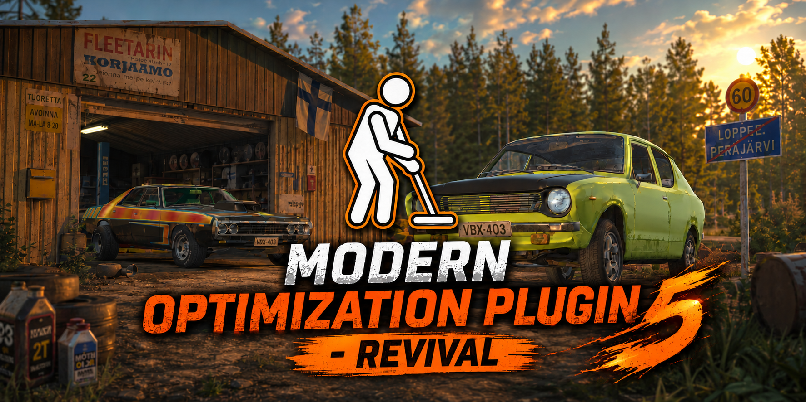

  

  
  
  

  <b>More FPS in My Summer Car. Install it and play, no setup needed.</b> 
  The continuation of MOP (Modern Optimization Plugin) by Athlon, rebuilt for the current game and MSCLoader.

  <a href="https://github.com/ANICKONS/MOP-REVIVAL/releases/latest"><b>Download</b></a> ·
  <a href="https://www.nexusmods.com/mysummercar/mods/11595"><b>Nexus</b></a> ·
  <a href="https://anickons.github.io/MOP-REVIVAL/"><b>Mod compatibility</b></a> ·
  <a href="CHANGELOG.md"><b>Changelog</b></a> ·
  <a href="https://github.com/ANICKONS/MOP-REVIVAL/issues"><b>Report a bug</b></a>

---

## Features

- **Far away is switched off.** Places, vehicles, items and world objects you can't reach are turned off and come
  back before you get close. This is the proven engine of the original MOP.
- **Faster game scripts.** The game's logic skips work that would change nothing, so it behaves exactly the same,
  just faster.
- **Lighter rendering.** Tiny distant objects and their shadows aren't drawn, and the parked Satsuma is drawn as
  one piece.
- **Your save stays safe.** Paint, fluids, bolts and doors don't jump back to the last save when objects come back on.
- **Old bugs fixed.** Walkers that never showed up, food spoiling too slowly, the kilju bucket spilling on load
  and more.
- **Works with your mods.** Built-in rules for 43 popular mods, plus your own rules if you need them.
- **English, Russian and Polish.** Switch the language in the mod settings.

> Every change is measured in the game before release. Results may vary with your PC and save.

## Installation

You need a **legal, up-to-date copy** of My Summer Car and [MSCLoader](https://github.com/piotrulos/MSCModLoader/releases) 1.4.2 or newer.

1. Download `MOPR.dll` from [Releases](https://github.com/ANICKONS/MOP-REVIVAL/releases/latest).
2. Put it into the game's `Mods` folder.
3. If you have the original MOP (`MOP.dll`), remove it: the two can't run together.

That's it. The settings are in MSCLoader's mod list, next to MOP - REVIVAL.

Coming from MOPR 4.x? `Mods\References\MOPRNET.dll` is no longer needed and can be deleted.

## Compatibility

**[Check your mods on the compatibility site](https://anickons.github.io/MOP-REVIVAL/)**: what works, what MOP - REVIVAL
does for each mod, and a button to request support for a new one.

Rules for these mods are built in and switch on by themselves:

<b>43 supported mods</b>

 

ActualMop, AthlonsTweaksPack, BetterMSC, BodyPillow, BottleRecycling, CallYourCousin, CDPlayer, ColorfulGauges3,
dazyWoodDash, DonnerTech_ECU_Mod, DrivableBus, DriveableSvoboda, Expanded_Winter_Features, FishingMod, FURY, g_Box,
GAZ24, GifuPump, GlassesBox, GT_Interior, HayosikoColorfulGauges, JetSky, JONNEZ_Basket, KekmetAddons,
KekmetBeaconV2, LiquorStore, LoppeHouse, Manual_Ferndale, MSCStill, OffroadHayosiko, Partition, Police_Ferndale,
Projector_Headlights, PsychovanzRentApartment, Repairable_Ruscko, Roofless, Satsuma_LX, SatsumaDigidash,
SatsumaTurboCharger, SecondFerndale, SuperchargerForSatsuma, TangerinePickup, VHSPlayer

Need a rule for another mod? Use **Create your own rule file** in the settings. Old rule files of the original MOP
still work.

Use one optimization mod at a time: MOP - REVIVAL doesn't run together with the original MOP, KruFPS, ImproveFPS,
OptimizeMSC or DisableAll.

## Bugs and questions

Press **Report bug** next to MOP - REVIVAL in MSCLoader's mod list: the logs are attached for you. You can also open
an [issue](https://github.com/ANICKONS/MOP-REVIVAL/issues). Type `mopr help` in the console to see what the mod can do.

## Credits

- **ANICKON**: MOP - REVIVAL
- [**Konrad Figura (Athlon)**](https://github.com/Athlon007): the original [MOP](https://github.com/Athlon007/MOP).
  Most of the game logic here is his work.
- [**Krutonium**](https://github.com/Krutonium): the original [KruFPS](https://github.com/Krutonium/KruFPS), with
  RedJohn260 and EPS
- Est_Nbmstr for the name of the original MOP, FESilencer for help with PlayMaker
- Testers of the original MOP: DoritoMan, CatAtTheDesert, Slavic_Dude001, DJ Ötzi

## License

[GPLv3](LICENSE.md), like the original MOP. You're free to use the code as long as you credit the authors and
state your changes.

Contains AI-assisted code (disclosed as requested by MSCLoader).
